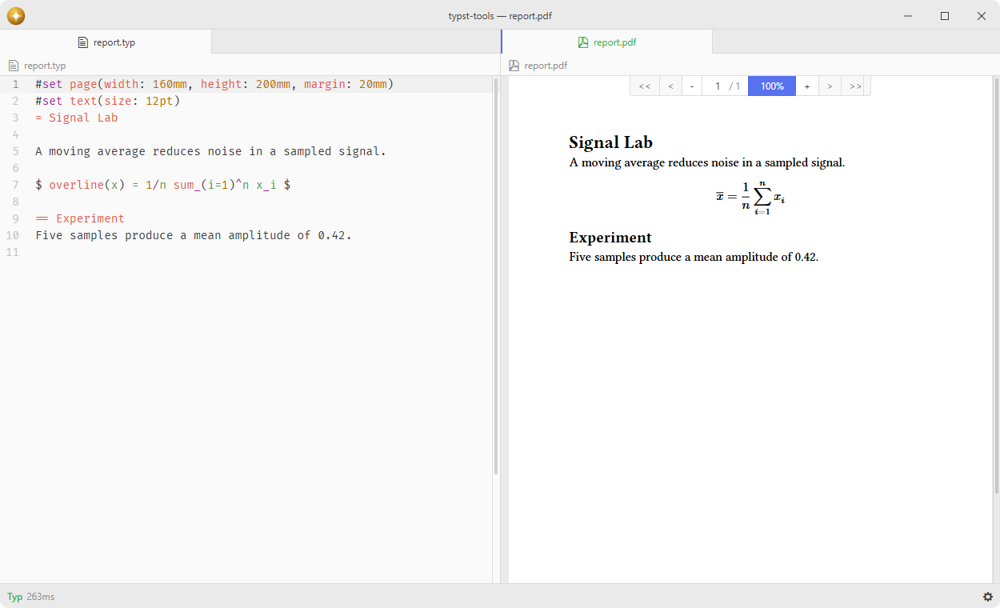

# typst-tools

Compile Typst documents with the typst CLI and view PDFs.

Uses Tasks for process execution, diagnostics and file observation, with a built-in Typst installer.

## Features

- **Compilation**: build documents using the `typst` compiler with configurable output format.
- **Compile-on-save**: automatically recompile observed files in the background, even after their editor is closed.
- **Observed files**: track every file watched for compile-on-save from a searchable list and the shared Tasks controls.
- **PDF viewing**: open output PDFs internally via [pdf-view](https://github.com/lumine-code/pdf-view).
- **Diagnostics**: report errors and warnings through Tasks, with clickable references to source locations.
- **Multiple builds**: compile multiple files simultaneously with independent build states.
- **Built-in installer**: download the Typst binary directly from GitHub releases.

## Installation

To install `typst-tools` search for it in the Install pane of the Lumine settings, or run the command `lumine --install lumine-code/typst-tools`.

## Usage

This package requires the `typst` binary. Run the `Typst Tools: Install Typst` command to download the latest Typst release from GitHub into the package's `bin/` directory, or install it manually:

- **Windows**: `winget install --id Typst.Typst` or download from [typst/typst releases](https://github.com/typst/typst/releases)
- **macOS**: `brew install typst`
- **Linux**: `cargo install typst-cli` or download from [typst/typst releases](https://github.com/typst/typst/releases)

If `typst` is not in your PATH, set the full path in the package settings under **Path to Typst**.

The `tasks` package must be installed and enabled. Typst Tools registers its compiler with the `tasks` service; Tasks owns execution, cancellation, output, diagnostics and compile-on-save observation. Typst Tools supplies compiler settings, parses Typst diagnostics and identifies the output files. Tasks controls are disabled while that service is unavailable.

Manual document builds save their open Typst source before starting the compiler, including requests sent directly through the shared service.

Compiler errors and warnings without a source location are attached to the beginning of the main document.

Tasks provides one shared status control for document builds, running tasks and retained output. Use **Packages > Typst Tools** for compilation, compile-on-save, stopping and PDF/source operations. Those commands act on the source document or the source associated with the focused PDF, so splitting the PDF and source works from either view. Opening output during a build waits for its successful completion. Several documents can compile independently.

In PDF View, F12 rebuilds the exact source associated by Typst Tools through the shared Tasks service without opening its panel, including existing PDFs with no build history.

Compile-on-save is tracked per file path rather than per editor, so an observed source keeps recompiling after you close its tab. Open **Typst Tools: Observed Files** to search those sources, open them or stop observing them. Observed files are not remembered between sessions.

Automatic compilation pauses while an open source document uses the None grammar. Selecting None cancels its queued automatic build and interrupts its running build; choosing a grammar lets later file changes compile again. The file remains on the observed-files list, and explicit build and file operations remain available.

## Commands

Commands available in `lumine-workspace`:

- `typst-tools:install-typst`: download and install the Typst binary from GitHub releases,
- `typst-tools:observed-files`: list the files observed for compile-on-save,
- `typst-tools:clear-all-observed-files`: stop observing every file at once,
- `typst-tools:compile`: compile the current Typst document,
- `typst-tools:watch`: toggle compile-on-save mode for the current file,
- `typst-tools:interrupt`: stop the current build process for the active file,
- `typst-tools:interrupt-all`: stop all running build processes,
- `typst-tools:clean-linter`: clear all linter messages,
- `typst-tools:open-pdf`: open the generated PDF in Lumine,
- `typst-tools:split-pdf-source`: open the PDF or its source in an adjacent pane,
- `typst-tools:stop-and-clear-diagnostics`: stop this document's build and clear diagnostics,
- `typst-tools:list-fonts`: list all fonts available to Typst.

Actions shown for `.typst-tools-observed-files-list`:

- `typst-tools:open-selected-file`: open the selected observed file,
- `typst-tools:open`: choose how and where to open the selected observed file,
- `typst-tools:open-external`: open the observed file in the configured external application,
- `typst-tools:show-in-folder`: reveal the observed file in the system file manager,
- `typst-tools:unobserve-selected-file`: stop observing the selected file,
- `typst-tools:clear-all-observed-files`: stop observing every file at once.

## Services

- [`tasks`](https://github.com/lumine-code/tasks/blob/master/docs/tasks.md): consumed to register the Typst compiler and run, observe, stop and inspect document builds. Other packages follow this shared service's jobs and artifacts.
- [`pdf-view.build-provider`](https://github.com/lumine-code/pdf-view/blob/master/docs/pdf-view.build-provider.md): provided so PDF View asks Typst Tools to identify its source and compile it through the shared backend.

## Contributing

Got ideas to make this package better, found a bug, or want to help add new features? Just drop your thoughts on GitHub. Any feedback is welcome!
